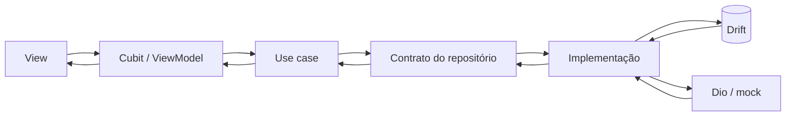

# Arquitetura do aplicativo

## 1. Objetivo

Definir uma arquitetura MVVM verificável, simples de explicar e capaz de manter
saldo, totais, extrato e detalhes coerentes sob cache, paginação e falhas de
rede.

## 2. Estilo arquitetural

O projeto usa organização por feature com camadas internas obrigatórias:

```text
View
  -> ViewModel
      -> Use case
          -> Repository contract
              -> Repository implementation
                  -> remote datasource
                  -> local datasource
```

Dependências apontam para dentro. O domínio não conhece Flutter, banco, HTTP ou
classes de apresentação.

## 3. Estrutura de `lib`

```text
lib/
├── app/
│   ├── app.dart
│   ├── config/
│   ├── di/
│   ├── router/
│   └── theme/
├── core/
│   ├── errors/
│   ├── formatters/
│   ├── network/
│   ├── preferences/
│   └── result/
└── features/
    └── financial_account/
        ├── domain/
        │   ├── entities/
        │   ├── repositories/
        │   ├── use_cases/
        │   └── value_objects/
        ├── data/
        │   ├── datasources/
        │   ├── dtos/
        │   ├── mappers/
        │   └── repositories/
        └── presentation/
            ├── dashboard/
            ├── statement/
            └── transaction_details/
```

Pastas só são criadas quando contêm uma responsabilidade real.

## 4. Responsabilidades

### View

- renderiza estados;
- encaminha intenções do usuário ao ViewModel;
- possui apenas estado efêmero estritamente visual;
- não calcula saldo, não consulta banco e não faz HTTP.

### ViewModel

- coordena casos de uso;
- publica estado imutável;
- controla loading, vazio, sucesso, erro e offline;
- preserva filtros, busca, paginação e posição necessária;
- converte resultados do domínio em informação pronta para a View.

### Domínio

- contém entidades e value objects financeiros;
- contém casos de uso e regras de cálculo;
- define contratos de repositório;
- representa falhas sem depender de exceções de infraestrutura.

### Dados

- implementa repositórios;
- integra fontes remotas e locais;
- valida e converte DTOs por mappers;
- aplica cache, paginação, deduplicação, cancelamento e retry;
- traduz falhas técnicas para o modelo de erros do domínio.

## 5. Fonte única de verdade

A fonte local é o estado canônico, e a sincronização remota
substitui o snapshot do Drift atomicamente. Dashboard, extrato e detalhes leem
o mesmo conjunto de entidades. Cache, expiração, cursor e retry estão definidos
no ADR 0009.

## 6. Dinheiro e datas

- Valores monetários são representados por `Money`, em centavos inteiros.
- Conversão e arredondamento pertencem ao domínio ou ao mapper, nunca ao widget.
- Datas externas e persistidas são UTC.
- Conversão para fuso local e formatação pt-BR ocorrem na fronteira de
  apresentação.

## 7. Navegação

Dashboard, extrato e detalhe usam rotas nomeadas. A rota de detalhe recebe
um identificador, não uma entidade completa. Isso evita estado duplicado e faz
o detalhe consultar a mesma fonte de verdade.

## 8. Stack aprovada

- `flutter_bloc`: ViewModels baseados em Cubit.
- `equatable`: igualdade por valor dos estados imutáveis.
- `get_it`: composition root e resolução central de dependências.
- `go_router`: rotas declarativas e nomeadas.
- `dio`: HTTP, interceptadores, timeout e cancelamento.
- `drift` e `drift_flutter`: cache estruturado e consultas reativas.
- `shared_preferences`: preferências simples pela API
  `SharedPreferencesAsync`.
- `intl`: formatação pt-BR.
- `fl_chart`: visualização da evolução financeira.

As justificativas e consequências estão nos [ADRs](adr/README.md).

## 9. Fluxo de dados



A atualização remota é validada e gravada em uma transação atômica. Leituras
posteriores de dashboard, extrato e detalhes saem do Drift, evitando versões
divergentes da mesma transação.

## 10. Limites conscientes

- O backend simulado é selecionado por configuração e usa somente dados
  fictícios.
- O snapshot completo simplifica sincronização e consistência para o volume do
  desafio; uma API de produção poderia exigir sincronização incremental.
- Preferências armazenam somente tema e visibilidade do saldo. Nenhum dado
  sensível é colocado em `SharedPreferences`.
